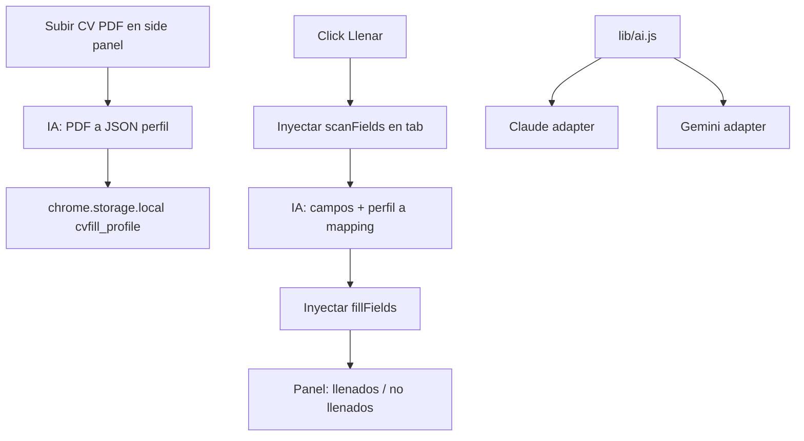

# CV Autofill Chrome Extension

**Objetivo:** Llenar formularios de postulación laboral (datos personales, experiencia, educación, incluyendo fechas) a partir de un CV en PDF, usando IA (Claude o Gemini). Reportar los campos que no se pudieron llenar.

---

## Stack (heredado de Rostar Extractor)

- Chrome MV3, vanilla JS, sin build ni dependencias
- `background.js` solo abre el side panel
- Side panel (`panel.html` + `panel.js`) concentra la UI y la orquestación
- `chrome.scripting.executeScript` inyecta scanner/filler en el tab activo (sin content scripts permanentes)
- `chrome.tabs.captureVisibleTab` opcional como contexto visual extra
- `chrome.storage.local` para proveedor, API keys, perfil del CV y último reporte
- `fetch` directo a la API de IA desde el panel

---

## Arquitectura



---

## Proveedor IA

- Selector en settings: solo `claude` o `gemini`
- Una API key y un modelo por proveedor
- Interfaz común en `lib/ai.js`:
  - `parseCV(pdfBase64) -> profile`
  - `mapFields(fields, profile) -> { mappings, unfilled }`
- Prompts compartidos en `lib/prompts.js`

### Claude adapter (`lib/providers/claude.js`)
- `POST https://api.anthropic.com/v1/messages`
- Headers: `x-api-key`, `anthropic-version: 2023-06-01`, `anthropic-dangerous-direct-browser-access: true`
- PDF como bloque `document`: `{ type: "document", source: { type: "base64", media_type: "application/pdf", data } }`
- Modelo default: `claude-haiku-4-5-20251001`
- JSON forzado vía prompt ("raw JSON only") + parse defensivo (extraer primer `{...}`)

### Gemini adapter (`lib/providers/gemini.js`)
- `POST https://generativelanguage.googleapis.com/v1beta/models/{model}:generateContent?key=...`
- PDF como `inline_data: { mime_type: "application/pdf", data }`
- `generationConfig: { responseMimeType: "application/json", responseSchema }`
- Modelo default: `gemini-2.5-flash`

---

## Flujos

### 1. Parseo del CV
- PDF a base64 vía `FileReader.readAsDataURL`
- IA devuelve schema fijo:

```js
{
  personal: { firstName, lastName, email, phone, city, state, country, zip, address, birthDate, nationality, linkedin, github, website },
  experience: [{ company, title, location, startDate, endDate, current, description }],
  education:  [{ institution, degree, field, startDate, endDate, gpa }],
  skills: [], languages: [{ name, level }], links: []
}
```

- Fechas normalizadas a `YYYY-MM` (o `YYYY-MM-DD` si hay día)
- Perfil editable en el panel antes de guardar

### 2. Escaneo del formulario (`scanFields`)
- Recorre `input`, `select`, `textarea`, `[contenteditable]`, `[role=combobox]`
- Incluye Shadow DOM e iframes same-origin
- Por campo:
  - `id` sintético (atributo `data-cvfill-id`)
  - `type`, `name`, `autocomplete`
  - label: `<label for>`, `aria-label`, `aria-labelledby`, `placeholder`, texto cercano
  - opciones (select/radio), `required`, visibilidad
  - grupo/sección (fieldset, heading más cercano)
- Detecta grupos repetibles (bloques de experiencia/educación) y botones "Add another"

### 3. Mapping
- Input: lista de campos + perfil
- Output:

```js
{
  mappings: [{ fieldId, value, confidence, source }],  // source: "experience[0].company"
  unfilled: [{ fieldId, label, reason }]
}
```

- Reglas: no inventar; adaptar formato de fecha al campo; en selects/radios usar el valor exacto de una opción existente

### 4. Llenado (`fillFields`)
- Setter nativo de `value` (`Object.getOwnPropertyDescriptor(HTMLInputElement.prototype, 'value').set`) + eventos `input`, `change`, `blur` (compatibilidad React/Angular/Vue)
- Por tipo:
  - `date` → `YYYY-MM-DD`; `month` → `YYYY-MM`
  - selects separados mes/año
  - radio/checkbox → `click()`
  - comboboxes custom → click, tipear, seleccionar opción
- Highlight: verde llenado, amarillo baja confianza, rojo no llenado

### 5. Reporte
- Lista en el panel de campos no llenados (label + motivo)
- Click en un item → `scrollIntoView` + focus del campo

### Experiencias múltiples
- Si hay más experiencias que bloques: click en "Add", re-escaneo, re-mapping (loop con tope, ej. 10)

---

## Manifest

```json
{
  "manifest_version": 3,
  "permissions": ["activeTab", "scripting", "sidePanel", "storage"],
  "host_permissions": [
    "<all_urls>",
    "https://api.anthropic.com/*",
    "https://generativelanguage.googleapis.com/*"
  ],
  "background": { "service_worker": "background.js" },
  "side_panel": { "default_path": "panel.html" }
}
```

---

## Storage

```js
// chrome.storage.local
{
  cvfill_provider: "claude" | "gemini",
  cvfill_keys:   { claude: "sk-ant-...", gemini: "AIza..." },
  cvfill_models: { claude: "claude-haiku-4-5-20251001", gemini: "gemini-2.5-flash" },
  cvfill_profile: { /* schema del CV */ },
  cvfill_last_report: { url, filled: [], unfilled: [], ts }
}
```

---

## Estructura de archivos

```
manifest.json
background.js
panel.html
panel.js
lib/ai.js
lib/prompts.js
lib/providers/claude.js
lib/providers/gemini.js
lib/scanner.js
lib/filler.js
icons/
```

- `scanner.js` / `filler.js`: funciones autocontenidas (requisito de `executeScript({ func })`, no pueden usar closures)

---

## Limitaciones conocidas

- Iframes cross-origin (Workday, Greenhouse embebidos) → requieren `allFrames: true` + `frameId`
- `input[type=file]` solo vía `DataTransfer`
- Captchas
- Formularios multi-paso (re-ejecutar por paso)

---

## Roadmap MVP

1. Settings proveedor/key + parseo CV + edición
2. Scan + fill de datos personales
3. Experiencias/educación con fechas
4. Reporte de no llenados
5. Multi-bloque y multi-paso
